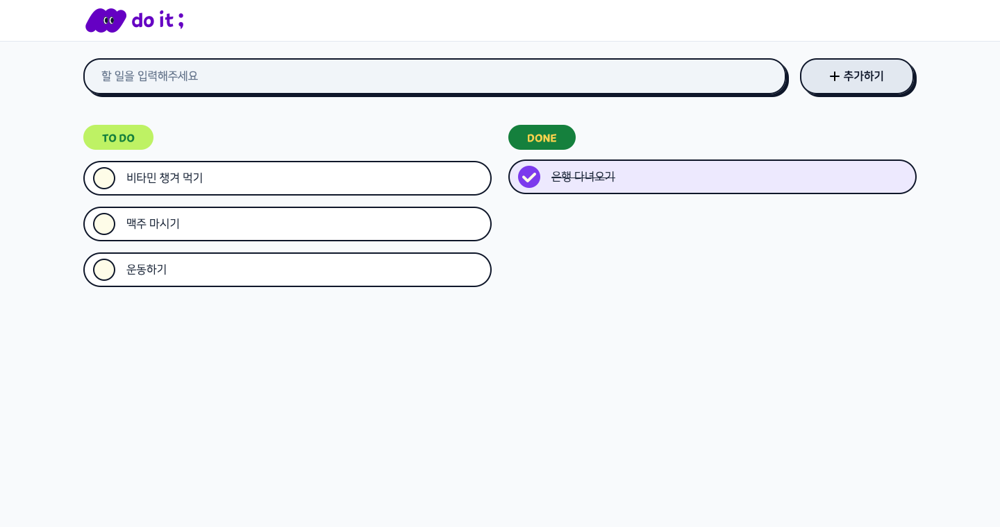
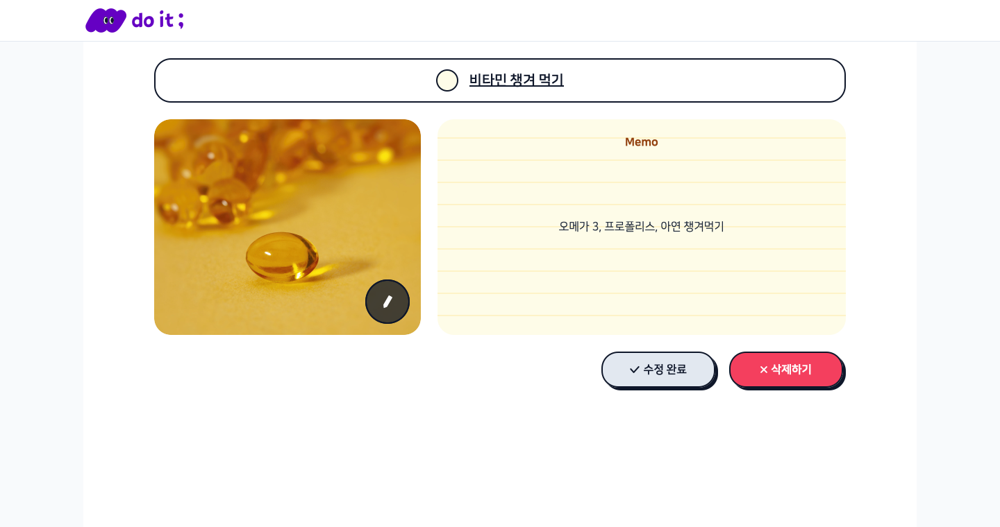
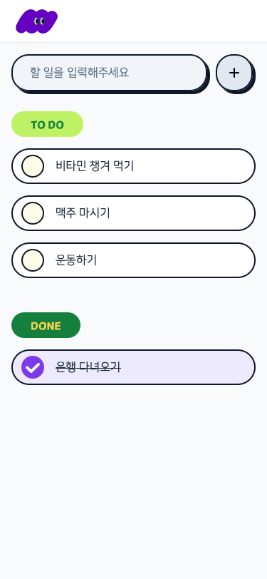
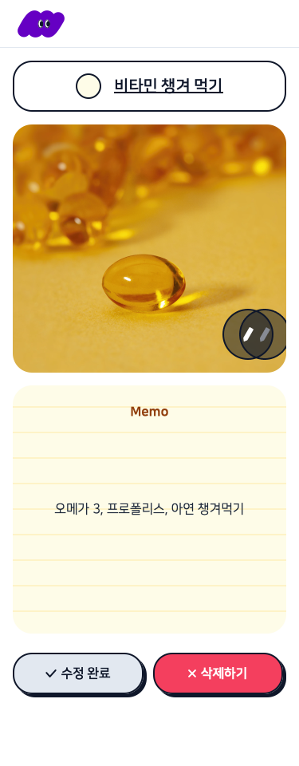

# do it; — Todo List

할 일을 추가하고, 완료로 체크하고, 메모와 사진을 붙여 관리하는 To Do 서비스입니다.

**배포 주소:** https://codeit-todo-nine.vercel.app

| 목록 (데스크탑) | 상세 (데스크탑) |
|---|---|
|  |  |

| 목록 (모바일) | 상세 (모바일) |
|---|---|
|  |  |

## 무엇을 하나요

코드잇 단기심화 지원자 과제로, 주어진 Figma 시안과 API 명세로 만든 Next.js 앱입니다. 시안의 모바일(375px), 태블릿(744px), 데스크탑(1920px) 화면을 모두 지원합니다.

**할 일 목록 (`/`)**
- 입력창에 할 일을 쓰고 **추가하기** 버튼을 누르거나 Enter를 치면 새 할 일이 생깁니다.
- 진행 중인 일(TO DO)과 완료한 일(DONE)을 나눠 보여 줍니다.
- 항목 왼쪽의 동그라미를 누르면 완료와 진행 중이 바뀝니다.
- 로고를 누르면 `/`로 이동하며 새로고침됩니다.
- 할 일이 없으면 빈 상태 일러스트와 안내 문구를 보여 줍니다.

**할 일 상세 (`/items/{itemId}`)**
- 이름, 완료 상태, 메모를 고칠 수 있습니다.
- 사진을 1장 붙일 수 있습니다. 파일 이름은 영어로만 되어 있어야 하고, 크기는 5MB 이하여야 합니다.
- **수정 완료**를 누르면 저장하고 목록으로 돌아갑니다. 바뀐 내용이 있을 때 버튼이 연두색으로 바뀝니다.
- **삭제하기**를 누르면 확인 후 삭제하고 목록으로 돌아갑니다.

## 기술 스택

- **프레임워크**: Next.js 16 (App Router) + React 19 — 과제 필수 스택
- **언어**: TypeScript — API 응답(`TodoSummary`, `TodoDetail`)을 타입으로 고정해 화면과 API의 어긋남을 막기 위해
- **스타일**: Tailwind CSS v4 — 시안의 컬러, 브레이크포인트, 그림자를 `@theme` 토큰 한곳에 모으기 위해
- **폰트**: NanumSquare (시안 지정 폰트)
- **배포**: Vercel

## 시작하기

Node.js 20 이상이 필요합니다.

```bash
git clone https://github.com/HUNMINRYU/codeit-todo.git
cd codeit-todo
npm install
npm run dev
```

브라우저에서 http://localhost:3000 을 엽니다.

프로덕션 빌드로 확인하려면:

```bash
npm run build
npm start
```

API의 tenantId는 기본값이 `hunminryu`입니다. 다른 데이터 공간을 쓰려면 환경 변수로 바꿉니다.

```bash
NEXT_PUBLIC_TENANT_ID=my-id npm run dev
```

## 어떻게 동작하나요

**API 연결** — 모든 요청은 `src/lib/api.ts`의 함수(`getTodos`, `createTodo`, `updateTodo`, `deleteTodo`, `uploadImage`)를 거칩니다. 실패 응답이면 서버 메시지를 담은 에러를 던지고, 화면에서 알림으로 보여 줍니다.

**사진 첨부** — 사진을 고르면 먼저 브라우저에서 이름과 크기를 검사합니다(`src/lib/validateImage.ts`). 통과하면 미리보기만 바꾸고, 실제 업로드는 **수정 완료**를 누를 때 합니다. 업로드로 받은 주소를 할 일의 `imageUrl`에 저장하는 두 단계 흐름입니다. 수정을 취소하면 쓰지 않을 사진이 서버에 올라가지 않습니다.

**완료 토글** — 체크하면 화면부터 바로 바꾸고 서버에 저장합니다. 저장이 실패하면 원래 상태로 되돌립니다.

**시안 맞춤** — 로고, 라벨, 아이콘, 일러스트는 Figma에서 SVG로 내보낸 원본입니다. 크기와 간격은 시안 프레임을 화면과 1:1로 겹쳐 비교하며 맞췄습니다. 메모는 시안처럼 짧은 글은 가운데, 긴 글은 제목 아래를 채우고 안에서 스크롤됩니다.

## 폴더 구조

```
src/
├─ app/
│  ├─ layout.tsx              # 공통 레이아웃 (상단 로고 바, 폰트)
│  ├─ globals.css             # 컬러·브레이크포인트·그림자 토큰
│  ├─ page.tsx                # 할 일 목록 페이지
│  └─ items/[itemId]/page.tsx # 할 일 상세 페이지
├─ components/                # 공용 컴포넌트
│  ├─ Gnb.tsx                 # 상단 로고 바
│  ├─ Button.tsx              # 추가·수정 완료·삭제 버튼
│  ├─ CheckBox.tsx            # 완료 토글 버튼
│  ├─ StatusLabel.tsx         # TO DO / DONE 라벨
│  ├─ TodoInput.tsx           # 입력창 + 추가 버튼
│  ├─ TodoItem.tsx            # 목록의 할 일 한 줄
│  ├─ TodoSection.tsx         # TO DO / DONE 묶음과 빈 상태
│  ├─ TodoDetail.tsx          # 상세 화면 본문
│  ├─ NameBar.tsx             # 상세 상단 이름·상태 바
│  ├─ ImageUpload.tsx         # 사진 첨부 영역
│  └─ Memo.tsx                # 줄노트 메모
├─ lib/
│  ├─ api.ts                  # API 요청 함수
│  └─ validateImage.ts        # 사진 이름·크기 검사
└─ types/todo.ts              # 할 일 데이터 타입
public/images/                # Figma에서 내보낸 SVG 에셋
```

## 컬러 시스템

| 토큰 | 값 | 쓰이는 곳 |
|---|---|---|
| slate-900 | `#0F172A` | 테두리, 그림자, 본문 강조 |
| slate-800 | `#1E293B` | 본문 글자 |
| slate-500 | `#64748B` | 입력창 안내 문구 |
| slate-400 | `#94A3B8` | 빈 상태 문구 |
| slate-300 | `#CBD5E1` | 사진 영역 점선 |
| slate-200 | `#E2E8F0` | 기본 버튼 배경, 구분선 |
| slate-100 | `#F1F5F9` | 입력창 배경 |
| violet-600 | `#7C3AED` | 추가 버튼(입력 중) |
| violet-100 | `#EDE9FE` | 완료한 항목 배경 |
| rose-500 | `#F43F5E` | 삭제하기 버튼 |
| lime-300 | `#BEF264` | 수정 완료 버튼(변경 있음) |
| amber-800 | `#92400E` | 메모 제목 |

## 개선하고 싶은 점

- [ ] 목록이 100개를 넘으면 다음 페이지를 이어 불러오기 (지금은 첫 100개만 조회)
- [ ] 알림 창(`alert`) 대신 화면 안에서 보이는 토스트 메시지
- [ ] 저장 중·불러오는 중 상태를 스켈레톤 화면으로 표시

## 라이선스

코드잇 단기심화 지원자 과제용으로 만든 저장소입니다.
